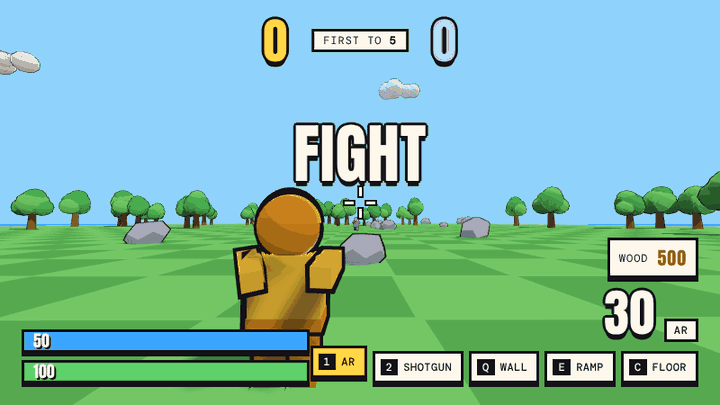
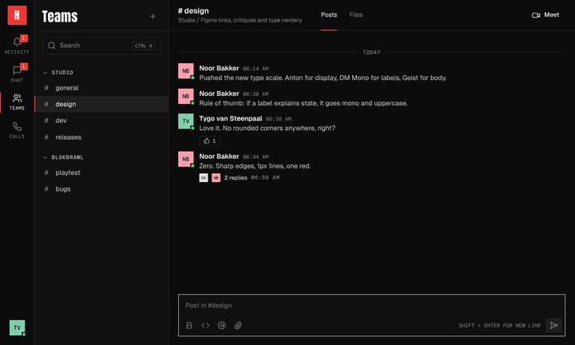
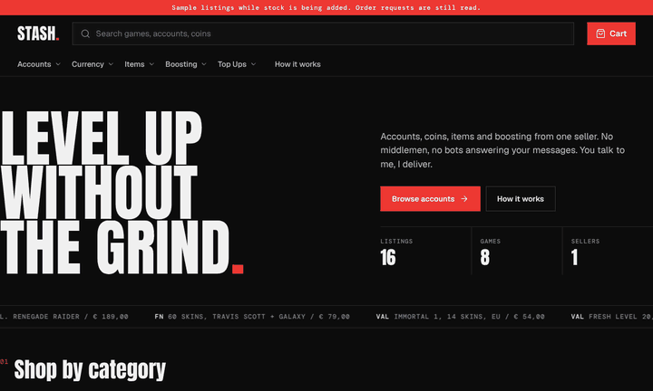
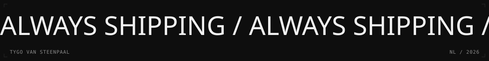

<a href="https://github.com/tygovansteenpaal/secure_vpn">PyVPN</a> &nbsp;/&nbsp; <a href="https://github.com/tygovansteenpaal/stravasa">Stravasa</a> &nbsp;/&nbsp; <a href="https://github.com/tygovansteenpaal/Site-s">Site-s</a> &nbsp;/&nbsp; <a href="https://www.linkedin.com/in/tygo-van-steen-37715a3a9">LinkedIn</a>
