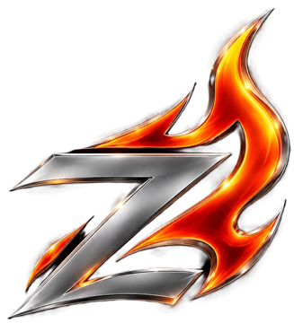

# Tygo van Steenpaal

Full-stack developer from the Netherlands. I turn ideas into projects you can open and use: games, web apps and tools.

 

## Projects

| Project | What it is | Built with | |
|:--|:--|:--|:--|
| **Zonefall** | Battle royale in the browser for up to 10 players, peer to peer, bots fill the rest |   |  |
| **Huddle** | Team chat with channels, threads, reactions and a call screen |   |  |
| **Stash** | My own game marketplace with search, filters and a cart |   |  |
| **PyVPN** | VPN built on TUN interfaces with modern cryptography |  |  |
| **Stravasa** | User platform with sign-in and profiles |   |  |

 

**Off the clock:** gym and gaming

